# Database relationships (schema version 6)

The diagram shows declared foreign keys. Saved names in relationship tables preserve references to catalog entries that no longer exist. Template image usage is tracked separately from placements so an asset can be shared by templates; image bytes are stored in SQLite.

```mermaid
erDiagram
    recipes ||--o{ menu : assigns
    recipes ||--o{ recipe_ingredients : contains
    ingredients o|--o{ recipe_ingredients : resolves
    ingredients ||--o{ ingredient_allergens : has
    allergens o|--o{ ingredient_allergens : resolves
    recipes ||--o{ recipe_additional_allergens : has
    allergens o|--o{ recipe_additional_allergens : resolves
    templates ||--o| template_documents : contains
    templates ||--o{ template_day_layouts : contains
    templates ||--o{ template_text_styles : contains
    templates ||--o{ template_block_appearances : contains
    templates ||--o{ template_image_placements : contains
    templates ||--o{ template_image_references : uses
    template_image_assets ||--o{ template_image_references : referenced_by
    recipes { integer id PK }
    ingredients { integer id PK }
    allergens { integer id PK }
    menu { integer id PK }
    recipe_ingredients { integer recipe_id FK }
    ingredient_allergens { integer ingredient_id FK }
    recipe_additional_allergens { integer recipe_id FK }
    templates { text name PK }
    template_documents { text template_name PK,FK }
    template_day_layouts { text template_name FK }
    template_text_styles { text template_name FK }
    template_block_appearances { text template_name FK }
    template_image_placements { text template_name FK }
    template_image_references { text template_name FK }
    template_image_assets { text id PK }
    settings { text key PK }
    meal_categories { integer position PK }
    recent_template_colors { integer position PK }
    menu_slot_categories {
        text date PK
        text slot PK
    }
    schema_migrations { integer version PK }
```

`template_documents`, styles, appearances, and placements store scalar model properties in individual columns. Day heights, meal categories, and recent colors use ordered rows. Image placements and the document retain asset IDs; `template_image_references` records the corresponding existing assets. `menu_slot_categories`, settings, and schema migrations are independent tables.
